  
  
  
  
  
  

## Projects

## Latest articles

<!-- ARTICLES:START -->
- [better-auth 1.7.16 security release: who is affected](https://ihsanalapsi.dev/articles/better-auth-1-7-16-security-release?lang=en) · Nov 9, 2026
- [Chrome 157 security update: 213 fixes and how to update](https://ihsanalapsi.dev/articles/chrome-157-security-update?lang=en) · Nov 9, 2026
- [OpenSSH 10.6p2 and the Alpine sshd password bypass](https://ihsanalapsi.dev/articles/openssh-musl-password-bypass?lang=en) · Nov 9, 2026
- [Rails Active Storage flaw: who is exposed and what to do](https://ihsanalapsi.dev/articles/rails-active-storage-critical-file-write?lang=en) · Nov 9, 2026
- [GitHub Actions blocks pull_request_target: check your repo](https://ihsanalapsi.dev/articles/github-pull-request-target-blocked?lang=en) · Nov 9, 2026
<!-- ARTICLES:END -->

[All articles on ihsanalapsi.dev →](https://ihsanalapsi.dev/articles?lang=en)

## Open source

| Project | What it does | Stack |
|---|---|---|
| [Nexus-REC](https://github.com/ihsanalapsi/Nexus-REC) | Automated recon and vulnerability assessment framework, on PyPI | Python |
| [Secure Clinic API Suite](https://github.com/ihsanalapsi/secure-clinic-api-suite) | Healthcare API with a security audit and fixes for 18 critical OWASP vulnerabilities | TypeScript, Node.js, PostgreSQL, Docker |
| [WhatsApp Number Extractor](https://github.com/ihsanalapsi/whatsapp-number-extractor) | Browser tool that exports the phone numbers of a WhatsApp group to CSV | TypeScript |
| [Baklava Ops Console](https://github.com/ihsanalapsi/baklava-ops-console) | B2B operations console on Trendyol's Baklava Design System, RTL and i18n | React Native, TypeScript |
| [Booking System](https://github.com/ihsanalapsi/booking-system) | Full-stack consultation booking system, built as a technical assessment | Next.js, tRPC, Prisma, PostgreSQL |

Istanbul · Arabic, Turkish, English · <a href="mailto:hello@ihsanalapsi.dev">hello@ihsanalapsi.dev</a>

<!-- The banner, the cards and the terminal are drawn by scripts/; a workflow refreshes the numbers, the articles and the snake every day. -->
